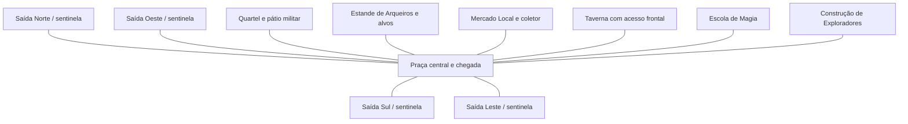

# Centro — expansão, circulação e nova arte

**Layout integrado às cenas finais do Centro e da Taverna.**
As cenas de protótipo e seus geradores foram retirados após a integração.
Use as cenas finais e os testes de produção. O [registro da limpeza](ApprovedPrototypeCleanup.md)
lista as remoções e os arquivos preservados. As etapas abaixo mantêm o histórico
das decisões e aprovações.

O layout V2 de cinco lotes, com **1.040 u²**, serviu de base para a
[planta V3 e sua revisão visual](CentroLayoutV3Review.html).
O [piloto da Taverna](TavernFacadePilotReview.html) foi aprovado e o
[conjunto de exteriores](CentroExteriorSetReview.html) e o
[terreno vivo V2](CentroTerrainV2Review.html) foram incorporados às cenas finais,
com o terreno convertido em um fundo único no formato dos mapas de produção.
A identidade dos HUDs aprovada nas etapas anteriores continua como referência.

O pull de `origin/GuzinTeste` até `2436b78` manteve o Centro e a Taverna de
produção vindos da branch. O protótipo de cinco lotes voltou a passar no smoke
após um ajuste local no tamanho do jogador. Isso estabelece que a cópia anterior
continua jogável. A versão de seis lotes usa o jogador e a fachada dos
Exploradores vindos da branch.

As quatro sentinelas e o coletor de impostos receberam
[sprites próprios](CentroPrototypeNpcPrompts.md) na cópia do Centro. O teste
de percurso continua usando as mesmas zonas de interação.

A revisão das colisões redesenhou o contorno interno da Taverna e posicionou
a saída sobre o tapete. No Centro, as bases dos seis edifícios e do mobiliário
foram alinhadas à arte. Os pátios dos Arqueiros e dos Exploradores têm entradas
livres e obstáculos sólidos ao fundo. Os contornos estão na
[prancha de colisões](CentroLayoutV3Review.html).

## Objetivo

Transformar o Centro em uma pequena praça medieval de fantasia com ruas amplas,
seis construções reconhecíveis, acesso evidente à Taverna e proporções coerentes
com o jogador de produção. Manter curtas e claras as rotas para serviços e os
quatro portões.

## O que muda com o pull

| Mudança recebida | Decisão para a integração |
|---|---|
| Construção de Exploradores (`ExplorationBuild`), com sprite, fundação e modal próprios | Acrescentar um sexto lote e um ramal a partir de uma rua existente. Reaproveitar `Exploration.png` e testar sua leitura ao lado do conjunto. Preservar a definição, os requisitos de ouro e materiais e o ganho de capacidade por nível. |
| Jogador com novos sprites, animações e medidas no prefab; ordenação de NPCs por profundidade | Usar o jogador de produção como régua da nova revisão. Medir a silhueta, os pés e o colisor em movimento, verificar portas e corredores, e conciliar a ordenação dos NPCs com a oclusão das fachadas e do poço. |
| Sentinelas reposicionados, câmera ajustada e mudança na configuração de spawn no Centro | Mapear a entrada e o retorno de cada portão na cena atual. Reposicionar gatilhos e âncoras conforme a planta de seis lotes e verificar o destino e o ponto de reaparecimento de cada rota. |
| Pandora e NPCs vindos da branch; interior da Taverna com relatório de exploração, recompensas e coleta | Manter os objetos e suas referências. Usar a Taverna de produção na validação integrada e ligar a nova soleira ao portal existente. A cópia do interior continua como referência do protótipo. |

Para o Centro expandido, a câmera segue o jogador e fica confinada ao terreno
com margem nas bordas. O movimento usa os limites do mapa no Centro; os demais
mapas continuam com a regra de movimento que já usam. A mudança de limites e
ordenação deve ser testada junto dos NPCs da branch.

## Direção espacial proposta

Praça central desimpedida, setores de serviço e ruas conectadas aos quatro
sentinelas. Manter os **1.040 u² de área total** da revisão V2 como referência.
Medir separadamente a área livre e a largura dos percursos após encaixar o sexto
lote. Comparar espaços livres da planta antes de propor deslocar um lote existente.



O esquema indica conexões. A planta V2 é a referência para Quartel e Arqueiros
no oeste, Mercado e Taverna no leste e Escola de Magia ao norte. Na V3, o sexto
lote fica no ramal nordeste, ligado à rua norte. A entrada fica ao sul do
edifício, fora do eixo da sentinela.
O coletor fica na área do Mercado. A praça recebe um marco pequeno, sem obstruir
o cruzamento das rotas principais. Adereços ocupam as bordas, preservando acessos.

## Régua de proporções

Usar o jogador real ao lado de cada fachada em todas as pranchas. Definir `H`
como sua altura visual e `W` como sua largura de colisão. Valores iniciais para
validar no protótipo, não medições do cenário atual:

| Elemento | Diretriz inicial |
|---|---|
| Porta de entrada | Altura de 1,25–1,5 H; largura livre de 1,3–1,8 W |
| Rua principal | Faixa caminhável livre de 6–8 W |
| Rua secundária | Faixa livre de 3–4 W |
| Aproximação de uma porta | Pelo menos 2 W livres antes da zona de interação |
| Edifício comum, incluindo telhado | Altura visual aproximada de 2,5–4 H |
| Torre da Escola de Magia | Até cerca de 4–5 H, validando oclusão e câmera |

Padronizar densidade de pixels, ângulo de visão, iluminação e ponto de apoio no
chão. Importar com bordas nítidas e pivô na base. A proporção deve vir da arte e
da unidade de escala comum; usar escala uniforme para ajustes finais.

## Pacote de sprites

Usar **exteriores independentes com transparência**, com acessos e identidade
visual reconhecíveis na escala de jogo. A Taverna foi o piloto dos cinco
exteriores locais. O sexto parte da arte recebida no pull.

| Construção | Identidade proposta |
|---|---|
| Quartel | Pedra, madeira, entrada robusta, estandarte vermelho e pequeno pátio |
| Estande de Arqueiros | Estrutura de madeira, cobertura leve e alvos no pátio |
| Escola de Magia | Edifício de pedra com torre moderada, emblema arcano e luz azul discreta |
| Mercado Local | Fachada comercial com toldo, balcão e mercadorias nas laterais |
| Taverna | Fachada acolhedora, porta destacada, placa de caneca e lanternas quentes |
| Construção de Exploradores | Fachada da branch, com acesso legível e escala, pivô e fundação conferidos na mesma prancha |

Usar madeira, pedra e ferro na paleta do jogo, com cor de classe/função em detalhes.
Manter o mesmo ponto de vista do jogador e do ambiente; verificar a leitura da
fachada na resolução real. Textos e prompts pertencem à interface, sem serem
desenhados dentro dos sprites.

O pacote local inclui cinco exteriores e uma fundação reutilizável. Conferir
os estados construído e não construído dos seis lotes, preservando as referências
e a progressão de cada definição de construção. Variações visuais por faixa
de nível ficam para um segundo passe, com o mesmo lote e a mesma posição de acesso.

## Fundo único do mapa

Substituir as malhas e texturas repetidas de terra, grama e pavimento do
protótipo por **uma imagem estática do terreno**, montada como um único sprite,
seguindo a estrutura do Centro de produção. Usar a planta de seis lotes como
guia para desenhar o fundo, com os acessos, os quatro portões e a margem da
câmera marcados antes de gerar a arte.

- Preservar da V2 o calçamento irregular, os caminhos de terra, a praça e as
  transições para a grama. Desenhar vegetação baixa, tufos e desgaste como parte
  da composição, com variação local e leitura nítida no zoom de jogo.
- Dimensionar a imagem a partir da área total visível, incluindo a margem
  além dos limites de movimento, e da densidade em pixels por unidade no
  enquadramento final. Conferir a resolução efetiva após importação no Unity,
  com filtragem Point e sem redução automática que apague detalhes da arte.
- Manter fachadas, fundações, NPCs, portais e objetos com colisão ou oclusão
  em camadas próprias. O poço e os bancos continuam independentes do chão.
  Alinhar o fundo aos acessos, aos colisores e às âncoras de retorno.
- Na cópia jogável, comparar o chão atual com o novo no mesmo enquadramento.
  Conferir terra e grama de perto, continuidade dos caminhos, alinhamento nas
  soleiras e cobertura nos extremos da câmera.

O protótipo usa [CentroStaticV3.png](../../Assets/Images/Map/CentroStaticV3.png),
com **6480 × 5616 px** e **108 pixels por unidade**. A geometria dos caminhos
foi renderizada no editor do Unity em um PNG, usando o calçamento anterior e
as [novas artes de terra e grama](CentroStaticV3Prompts.md).

O smoke do protótipo passou, incluindo os seis lotes, a melhoria da Construção
de Exploradores, impostos, acesso às quatro sentinelas e ida e volta da cópia
da Taverna. As capturas do Centro e do contorno interno da Taverna foram
geradas separadamente para revisão. Os hashes
das cenas de produção e da lista de cenas do build foram conferidos.

## Entrada e saída da Taverna

1. Abrir caminho contínuo da praça até uma porta voltada para a rua.
2. Posicionar a zona de entrada diante da soleira, alcançável pelo jogador e
   sem bloqueio do colisor do edifício.
3. Na porta, mostrar `[E] Entrar na Taverna`. A gestão usa uma placa lateral ou
   ponto separado, com `[E] Gerenciar Taverna`.
4. Reaproveitar a transição para a cena Taverna e conferir a saída do interior.
5. Ao voltar ao Centro, posicionar o jogador diante da porta, fora da zona que
   poderia provocar nova entrada; evitar reaparecer no centro da praça.
6. Manter a regra atual de construir antes de entrar. No nível 0, o ponto de
   gestão deve explicar e permitir a construção; não apresentar uma porta utilizável.

Nenhum outro interior novo faz parte deste escopo inicial.

## Execução em etapas

| Etapa | Entrega | Critério para avançar |
|---|---|---|
| 1 — Planta e escala (entregue) | Planta dos cinco lotes, ruas, spawns, medidas e uma prancha com jogador/portas | Planta revisável e escala de referência definida; conferência geométrica registrada |
| 2 — Protótipo jogável simples (entregue) | Cópias isoladas do Centro e Taverna, formas provisórias, limites do mundo, câmera e ida/volta | Teste funcional passou; revisão visual e avaliação do espaço disponíveis |
| 3 — Arte piloto (aprovada) | Fachada da Taverna e trecho de calçamento com o jogador | Usuário testou e validou; baseline do piloto registrada |
| 4A — Conjunto (entregue para revisão) | Cinco exteriores, fundações e terreno contínuo na cópia; ver CentroExteriorSetReview.html | Teste funcional passou; dez capturas candidatas à revisão artística |
| 4B — Compatibilização pós-pull (aprovada para integração) | Planta revisada com seis lotes e cópia jogável com o fundo estático, o jogador atual e os pontos de acesso reavaliados | Prancha com os seis acessos, praça, detalhes de terra e grama e extremos da câmera. |
| 4C — Integração ao Centro principal (aplicada) | Cenário, limites de movimento, câmera, fachadas e interações aplicados sobre as cenas de `2436b78`. Portais reais ligados. | Preservar saves, serviços, NPCs, os quatro portões e a ida e volta da Taverna. Conferir o diff de cena e registrar qualquer objeto ou asset cuja retirada seja necessária. |
| 5 — Revisão final | Sete testes PlayMode passaram, incluindo as transições da Taverna e dos quatro portões, construções, impostos, recrutamento, exploração e preservação de um save de teste. | A captura geral e a vista da placa de gestão foram atualizadas na prancha. |

A integração manteve os componentes de serviço das cenas originais. Na
Taverna, os dois componentes de colisão antigos do piso foram substituídos
por um contorno que segue as paredes e a soleira. O quadro de exploração
mantém o controlador e o relatório de região e passa a ter uma área de
interação sobre o piso acessível. O retorno ao Centro usa uma âncora diante
da fachada, sem campos novos no save. Os quatro portões mantêm suas âncoras
de retorno específicas.

A comparação das cenas preservou todos os objetos originais. Na Taverna,
somente os dois componentes antigos de colisão do piso saíram, substituídos
pelo novo contorno. No Centro, o sprite de prévia de caminhada foi ocultado
para evitar um segundo personagem visível na praça.

O antigo comando **TCC Game → World → Apply Approved Centro Layout** concluiu a
transferência e foi retirado junto com as cópias de protótipo. As
[capturas das cenas finais](CentroLayoutV3Review.html) ficam junto das
comparações do protótipo.

## Validação enxuta

- Uma rodada funcional por marco. Na 4B, verificar chegada, acesso aos seis lotes,
  colisões e rotas no protótipo. Na 4C, reutilizar os smokes focados em construções
  e impostos e exercitar os quatro portões com retorno, entrada e saída da
  Taverna com a regra de construção e uma consulta ao relatório de exploração.
  Conferir também uma partida existente e os bloqueios dos modais.
- Cobrir no smoke de construção a falta de materiais mesmo com ouro suficiente,
  o desconto de ouro e recursos e o aumento de capacidade ao melhorar a
  Construção de Exploradores. O teste de produção recebido no pull já cobre
  esse fluxo.
- Colisão acompanha a base física do prédio; telhados e partes altas usam ordem
  de desenho coerente com os pés do jogador. Não criar barreiras invisíveis nas ruas.
- Revisão visual separada em 1920 × 1080 e 1366 × 768: visão geral, escala das
  seis fachadas com o jogador, porta da Taverna, acesso dos Exploradores e
  extremos da câmera. Incluir recortes de terra e grama na escala de jogo,
  comparando com a galeria V2. Usar a baseline de HUD para componentes e modais.
- Preservar as regras e os saves econômicos. Troca de fundo/cenário exige novas
  referências do mundo; não aceitar nem reprovar o HUD apenas por diferenças
  de pixels do terreno. Comparar seus componentes separadamente.
- Aprovação de arte e composição por imagem; testes de código verificam o fluxo.
  Não repetir a suíte completa para cada ajuste visual.

## Fontes locais do levantamento

- `Assets/Scenes/Centro.unity` e `Assets/Scenes/Taverna.unity`.
- `Assets/Scripts/Player/moviment.cs`.
- `Assets/Scripts/Navigation/TavernScenePortal.cs`, `PlayerSpawnController.cs`
  e `SceneTransitionController.cs`.
- `Assets/Scripts/Core/Input/PlayerInteractor.cs`.
- `Assets/Scriptable/Buildings/` e `Assets/Images/Buildings/taverna.png`.
- `Assets/Images/Map/CentroBackgroundv2.png`.
- `Assets/Scriptable/Buildings/ExplorersLodge.asset`, `Assets/Images/Buildings/Exploration.png`
  e `Assets/Tests/PlayMode/CentroBuildingSmokeTests.cs`.
- [Fluxo do mapa e relatório de exploração](../../Docs/ExplorationMapSetup.md).

## Próxima etapa — profundidade dos personagens e vendedor imóvel

Planejamento e implementação de 09/11/2026. Aplicado às três cenas finais e
aos quatro prefabs de aventureiros; validação funcional concluída.

### Diagnóstico

- `moviment.cs` ordena os NPCs sem `WorldPrototypeDepthSort` em relação ao
  jogador usando a borda inferior da imagem. Já `WorldPrototypeDepthSort`
  calcula uma ordem absoluta a partir da borda inferior do colisor dos pés.
  São referências diferentes, sensíveis às margens da arte, à animação e ao
  tamanho do colisor. O jogador também precisa seguir a mesma convenção.
- O vendedor `NPCVenta` da cena Portão possui `Rigidbody2D` dinâmico, gravidade
  zero e somente a rotação travada. Seu círculo sólido recebe contatos e a
  posição continua livre, permitindo que seja empurrado.

### 1. Impedir que o vendedor seja empurrado

- Alterar o corpo do vendedor estacionário para `Static`, com simulação ativa.
  Manter o círculo sólido no pé e o trigger ampliado de interação separados.
- Conferir a configuração nos scripts que preparam a cena para que uma nova
  aplicação do layout não restaure o corpo dinâmico.
- Aceite: pressionar o vendedor pelos quatro lados não altera sua posição nem
  rotação; o jogador é bloqueado pelo círculo e continua podendo abrir, comprar
  e fechar o recrutamento dentro da área de interação.

### 2. Unificar a ordenação pela posição dos pés

- Usar um único mecanismo para jogador e NPCs no Centro, Portão e Taverna,
  incluindo os aventureiros criados em execução pelos prefabs de contratação.
- Definir uma âncora de chão fixa por personagem, alinhada ao centro do círculo
  dos pés. A referência não dependerá do tamanho da imagem, da animação ou do
  trigger ampliado. Registrar offsets por prefab quando a origem da arte exigir.
- Reaproveitar o componente existente e a convenção de profundidade do cenário:
  maior Y desenha atrás, menor Y desenha na frente, na mesma Sorting Layer.
  Garantir atualização após o movimento e desempate estável para alturas iguais.
- Migrar os personagens antes de retirar de `moviment.cs` a atribuição antiga
  das ordens dos NPCs. Cada renderer terá um único responsável pela profundidade.
- Conferir a compatibilidade com `WorldBuildingView`, fachadas, pátios e objetos
  de cenário, ajustando as referências de chão onde necessário. Em personagens
  compostos por vários sprites, avaliar `SortingGroup` para mantê-los unidos.
- Aceite: os pés do jogador acima dos pés do NPC fazem o jogador aparecer atrás;
  abaixo fazem aparecer na frente. A ordem fica estável parado e durante animações.

### 3. Validar física e aparência separadamente

- Uma rodada focada de testes para a imobilidade do vendedor, interação e compra,
  troca de ordem nos dois sentidos e ordenação de um NPC criado em execução.
- Capturas reproduzíveis com o jogador acima e abaixo de NPCs representativos
  nas três cenas. Conferir também passagem diagonal, mesma altura e oclusão pelas
  fachadas e objetos próximos; reutilizar o framework visual já existente.
- Entregar as capturas com o resultado funcional. A aprovação visual continua
  separada do teste de código; não substituir automaticamente baselines de HUD.
- Preservar as mudanças atuais de layout, arte, distância de interação e saves.

Referências oficiais: [ordenação de sprites](https://docs.unity.com/en-us/engine/6000.0/manual/unity2d/sprite/sort-sprites/2d-renderer-sorting)
e [comportamento de um corpo estático](https://docs.unity3d.com/6000.0/Documentation/ScriptReference/RigidbodyType2D.Static.html).

### Resultado da implementação

- Jogador, cinco NPCs do Centro, três NPCs do Portão e aventureiros instanciados
  na Taverna usam o mesmo componente. A âncora é o offset fixo do colisor sólido
  dos pés transformado para o mundo. O jogador fica na frente em alturas iguais.
  A ordenação antiga por tag e limites do sprite foi retirada de `moviment.cs`.
- Objetos do cenário mantêm sua referência pela borda da base. Fachadas e
  transparência de telhados consultam o mesmo ponto de chão do jogador.
- O vendedor usa `Rigidbody2D.Static`. A configuração também é preservada pelo
  gerador do menu de recrutamento. O menu **TCC Game → World → Apply Character
  Depth and NPC Physics** reaplica a configuração de profundidade e física.
- [Sete testes PlayMode passaram](../../Logs/CharacterDepthSmoke.xml): ordem
  acima/abaixo e desempate nas três cenas, NPCs gerados na Taverna, contato pelos
  quatro lados do vendedor, recrutamento, construções, modais e viagens.
- A comparação com as cópias anteriores desta execução não encontrou remoções
  de objetos/componentes nem alterações em transforms ou na geometria dos
  colisores existentes nas três cenas.
- Foram geradas e inspecionadas seis capturas. São candidatas de revisão;
  nenhuma baseline visual existente foi substituída.

| Cena | Jogador acima, atrás do NPC | Jogador abaixo, na frente do NPC |
|---|---|---|
| Centro | [Captura](../../Artifacts/VisualTests/character-depth-centro/captures/player-behind-1366x768.png) | [Captura](../../Artifacts/VisualTests/character-depth-centro/captures/player-in-front-1366x768.png) |
| Portão | [Captura](../../Artifacts/VisualTests/character-depth-gate/captures/player-behind-1366x768.png) | [Captura](../../Artifacts/VisualTests/character-depth-gate/captures/player-in-front-1366x768.png) |
| Taverna | [Captura](../../Artifacts/VisualTests/character-depth-tavern/captures/player-behind-1366x768.png) | [Captura](../../Artifacts/VisualTests/character-depth-tavern/captures/player-in-front-1366x768.png) |

Para repetir somente as capturas em uma execução do Unity:

```powershell
.\tools\Test-Visual.ps1 -Scenario 'character-depth-centro,character-depth-gate,character-depth-tavern'
```
