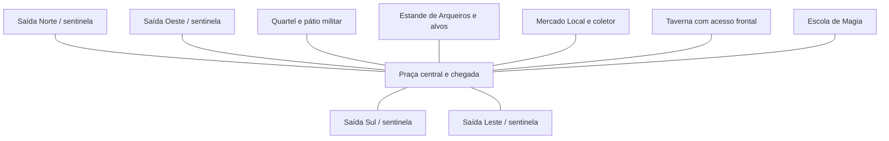

# Centro — expansão, circulação e nova arte

Status: proposta de planejamento. A cena e os sprites de produção não foram
alterados por este levantamento. O escopo passa a incluir o espaço do mundo;
a identidade dos HUDs aprovada nas etapas anteriores continua como referência.

## Objetivo

Transformar o Centro em uma pequena praça medieval de fantasia com ruas amplas,
cinco construções reconhecíveis, acesso evidente à Taverna e proporções coerentes
com o jogador. Manter curtas e claras as rotas para serviços e os quatro portões.

## Diagnóstico da cena atual

- `moviment.ClampToCameraViewport()` prende o jogador ao retângulo visível da
  câmera em cada quadro. A expansão precisa de limites do mapa independentes da
  tela e de revisão desse comportamento no Centro, preservando os demais mapas.
- A cena já possui Cinemachine seguindo o jogador. Falta planejar o enquadramento
  e confinar a câmera ao novo terreno, sem expor áreas vazias nas bordas.
- O fundo atual é uma imagem única com quatro lotes em torno da praça. O Centro
  possui cinco edifícios, incluindo a Taverna. O novo desenho deve prever cinco
  lotes próprios e corredores contínuos entre eles.
- Construções usam escalas distintas, inclusive escala diferente nos eixos X/Y.
  Isso dificulta comparar a altura de portas, personagens, telhados e adereços.
- A Taverna usa `taverna.png`, uma imagem de interior, como sprite do edifício
  externo. Precisa de uma fachada própria.
- `TavernScenePortal` e sua zona de entrada já estão na cena. O acesso exige
  Taverna construída; a intenção é tornar a porta visível, alcançável e inequívoca.
- A escolha de interação usa distância ao objeto. As zonas de porta e de gestão
  devem ser separadas e verificadas para evitar que uma ação esconda a outra.

## Direção espacial proposta

Praça central desimpedida, dois setores de serviço e ruas conectadas aos quatro
sentinelas. Como ponto de partida, buscar cerca de **duas vezes a área caminhável
útil atual**; medir a área livre no protótipo e ajustar pela experiência de percurso.
Essa meta é de área utilizável, não uma multiplicação de largura e altura.

O esquema indica conexões, não a posição final ou a escala dos lotes. A primeira
planta deve testar Quartel/Arqueiros no setor oeste e Mercado/Taverna no setor
leste, com a Escola de Magia em lote próprio ao norte, deslocada do eixo da rua.
O coletor fica na área do Mercado. A praça recebe um marco pequeno, sem obstruir
o cruzamento das rotas principais. Adereços ocupam as bordas, preservando acessos.

## Régua de proporções

Usar o jogador real ao lado de cada fachada em todas as pranchas. Definir `H`
como sua altura visual e `W` como sua largura de colisão. Valores iniciais para
validar no protótipo, não medições do cenário atual:

| Elemento | Diretriz inicial |
|---|---|
| Porta de entrada | Altura de 1,25–1,5 H; largura livre de 1,3–1,8 W |
| Rua principal | Faixa caminhável livre de 6–8 W |
| Rua secundária | Faixa livre de 3–4 W |
| Aproximação de uma porta | Pelo menos 2 W livres antes da zona de interação |
| Edifício comum, incluindo telhado | Altura visual aproximada de 2,5–4 H |
| Torre da Escola de Magia | Até cerca de 4–5 H, validando oclusão e câmera |

Padronizar densidade de pixels, ângulo de visão, iluminação e ponto de apoio no
chão. Importar com bordas nítidas e pivô na base. A proporção deve vir da arte e
da unidade de escala comum; usar escala uniforme para ajustes finais.

## Pacote de sprites

Produzir cinco **exteriores independentes com transparência**, com portas e
identidade visual reconhecíveis na escala de jogo. Validar uma construção piloto
com o jogador e o terreno antes de gerar o restante do conjunto.

| Construção | Identidade proposta |
|---|---|
| Quartel | Pedra, madeira, entrada robusta, estandarte vermelho e pequeno pátio |
| Estande de Arqueiros | Estrutura de madeira, cobertura leve e alvos no pátio |
| Escola de Magia | Edifício de pedra com torre moderada, emblema arcano e luz azul discreta |
| Mercado Local | Fachada comercial com toldo, balcão e mercadorias nas laterais |
| Taverna | Fachada acolhedora, porta destacada, placa de caneca e lanternas quentes |

Usar madeira, pedra e ferro na paleta do jogo, com cor de classe/função em detalhes.
Manter o mesmo ponto de vista do jogador e do ambiente; verificar a leitura da
fachada na resolução real. Textos e prompts pertencem à interface, sem serem
desenhados dentro dos sprites.

O primeiro pacote inclui os cinco exteriores e uma representação coerente de
lote/fundação não construído, substituindo marcadores provisórios. O solo deve
ter peças reaproveitáveis de pavimento, terra, grama e bordas para permitir a
expansão. Variações visuais por faixa de nível ficam para um segundo passe,
reutilizando o mesmo lote e a mesma posição de porta. Não são necessárias dez
artes por edifício para preservar os dez níveis de melhoria existentes.

## Entrada e saída da Taverna

1. Abrir caminho contínuo da praça até uma porta voltada para a rua.
2. Posicionar a zona de entrada diante da soleira, alcançável pelo jogador e
   sem bloqueio do colisor do edifício.
3. Na porta, mostrar `[E] Entrar na Taverna`. A gestão usa uma placa lateral ou
   ponto separado, com `[E] Gerenciar Taverna`.
4. Reaproveitar a transição para a cena Taverna e conferir a saída do interior.
5. Ao voltar ao Centro, posicionar o jogador diante da porta, fora da zona que
   poderia provocar nova entrada; evitar reaparecer no centro da praça.
6. Manter a regra atual de construir antes de entrar. No nível 0, o ponto de
   gestão deve explicar e permitir a construção; não apresentar uma porta utilizável.

Nenhum outro interior novo faz parte deste escopo inicial.

## Execução em etapas

| Etapa | Entrega | Critério para avançar |
|---|---|---|
| 1 — Planta e escala | Planta dos cinco lotes, ruas, spawns, medidas e uma prancha com jogador/portas | Planta revisável e escala de referência definida |
| 2 — Protótipo jogável simples | Cópia isolada da cena com formas provisórias, limites do mundo, câmera e ida/volta da Taverna | Caminhar por todas as rotas, contornar prédios e entrar/sair sem conflito de interação |
| 3 — Arte piloto | Uma fachada, preferencialmente Taverna, e um trecho de rua com o jogador | Aprovar proporção, perspectiva, textura e leitura da porta em captura real |
| 4 — Conjunto e integração | Cinco exteriores, fundações, terreno expandido, colisores e pontos de interação alinhados | Revisar o conjunto no jogo e manter as ações de construção/melhoria funcionando |
| 5 — Revisão final | Capturas do mundo e dos HUDs, verificação do percurso e transições | Confirmar composição, navegação, ausência de sobreposições e funcionamento dos serviços |

O protótipo inicial deve ficar em uma cópia própria, sem substituir o Centro
atual. A cena de produção recebe a nova composição após a revisão da planta,
da circulação e da arte piloto. A revisão integrada de HUDs que estava pendente
passa a encerrar esta reformulação, no novo contexto visual.

## Validação enxuta

- Um roteiro funcional por entrega relevante: chegada, acesso aos cinco edifícios,
  impostos, entrada/saída da Taverna e aproximação das quatro saídas. Incluir
  Taverna não construída e construída, respeitando os bloqueios dos modais.
- Colisão acompanha a base física do prédio; telhados e partes altas usam ordem
  de desenho coerente com os pés do jogador. Não criar barreiras invisíveis nas ruas.
- Revisão visual em 1920 × 1080 e 1366 × 768: visão geral, escala das cinco
  fachadas com o jogador, porta da Taverna e extremos da câmera.
- Preservar as regras e os saves econômicos. Troca de fundo/cenário exige novas
  referências do mundo; não aceitar nem reprovar o HUD apenas por diferenças
  de pixels do terreno. Comparar seus componentes separadamente.
- Aprovação de arte e composição por imagem; testes de código verificam o fluxo.
  Não repetir a suíte completa para cada ajuste visual.

## Fontes locais do levantamento

- `Assets/Scenes/Centro.unity` e `Assets/Scenes/Taverna.unity`.
- `Assets/Scripts/Player/moviment.cs`.
- `Assets/Scripts/Navigation/TavernScenePortal.cs`, `PlayerSpawnController.cs`
  e `SceneTransitionController.cs`.
- `Assets/Scripts/Core/Input/PlayerInteractor.cs`.
- `Assets/Scriptable/Buildings/` e `Assets/Images/Buildings/taverna.png`.
- `Assets/Images/Map/CentroBackgroundv2.png`.
