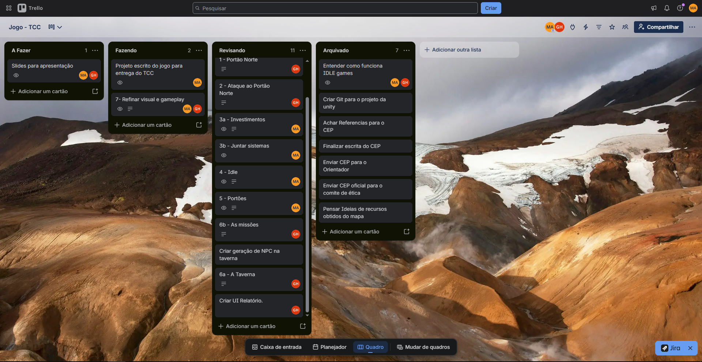
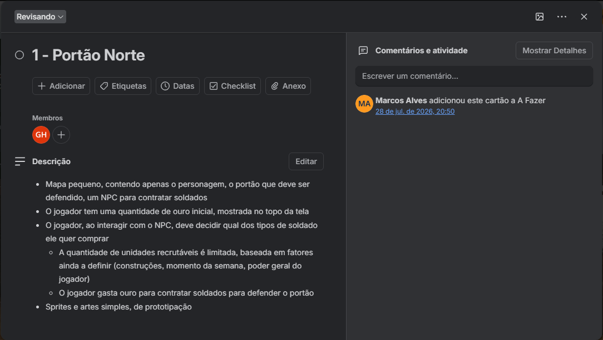
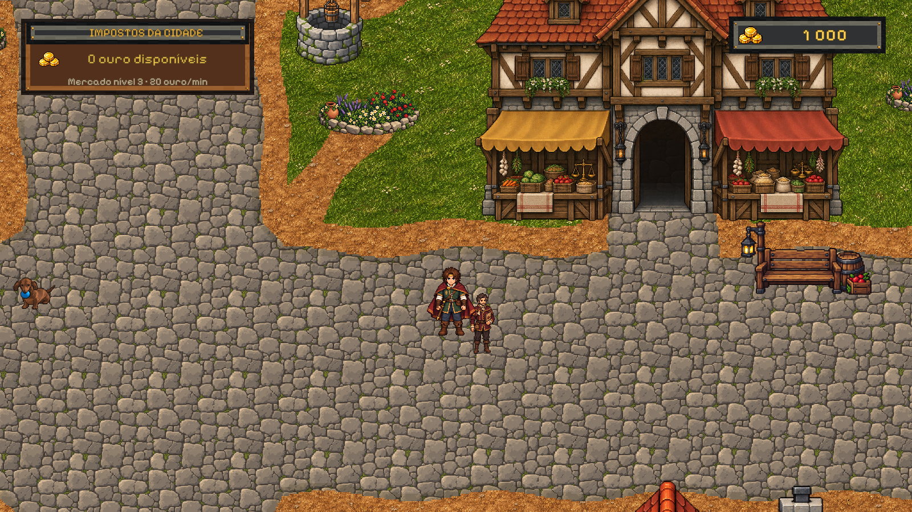
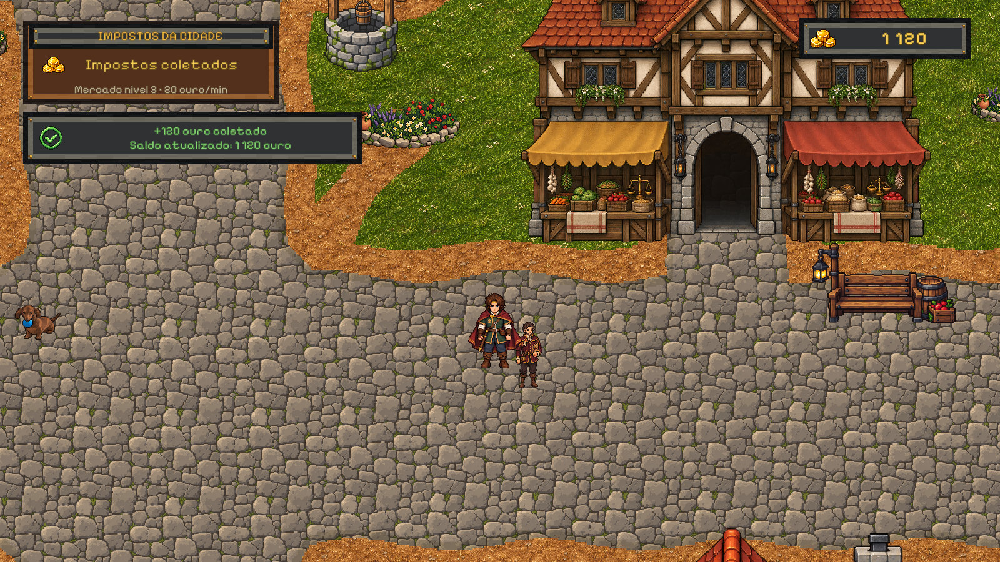

# PROCESSOS DE DESENVOLVIMENTO DE JOGOS INDIES

**Autores:** Gustavo Henrique Nascimento de Almeida; Marcos Vinicius Barbieri Alves

**Instituição:** Centro Universitário da Fundação Hermínio Ometto

**Curso:** Engenharia da Computação

**Orientador:** Prof. Dr. Maurício Acconcia Dias

**E-mails institucionais:** [preencher]

## Resumo

Este trabalho analisa como uma equipe de dois estudantes planejou, implementou e testou o progresso com o jogo fechado em um protótipo *idle* 2D. O estudo de caso examinou os registros de gestão, o histórico do Git e a implementação. A verificação automatizada gravou partidas em chaves isoladas, carregou o estado em novas sessões e simulou o tempo de ausência com um relógio controlado. Os 23 casos selecionados foram aprovados, incluindo oito cenários de retomada. Ausências simuladas de 24 e 48 horas produziram o mesmo valor de impostos. Após a coleta e um novo carregamento, o saldo foi preservado sem duplicar o crédito. A campanha retomou do tempo salvo. O estudo indica que definir quais mecânicas consideram o tempo de ausência orienta a divisão das tarefas, a escolha dos dados a salvar e os testes. A verificação no executável, com encerramento e reabertura, permanece pendente.

**Palavras-chave:** jogos idle, desenvolvimento independente, progressão offline

## 1 Introdução

### 1.1 Contextualização

Este trabalho descreve o desenvolvimento de um jogo independente por dois estudantes de Engenharia da Computação. A equipe precisou decidir quais mecânicas implementar primeiro e como testar sua integração. Essas decisões envolvem gestão e produção, duas áreas em que Politowski et al. (2021) identificaram dificuldades ao analisar 200 relatos de projetos de jogos.

No jogo 2D, desenvolvido em Unity e C#, o jogador administra uma vila atacada por ondas de monstros. Antes de cada ataque, pode investir em construções, recrutar tropas e distribuí-las pelos portões. Também pode enviar aventureiros em expedições para obter materiais usados nas construções.

O jogo adota elementos do gênero *idle*, em que parte do progresso ocorre com pouca interação direta (ALHARTHI et al., 2018). Um exemplo é a arrecadação de impostos, que leva em conta o tempo em que o jogo ficou fechado.

### 1.2 Problema de pesquisa

Ao retomar uma partida, o jogo precisa calcular quanto progresso corresponde ao tempo em que ficou fechado. A equipe precisa definir quais mecânicas usam esse intervalo, quais dados devem ser salvos e quanto progresso pode ser acumulado. Essas escolhas orientam a ordem de implementação e os testes para períodos curtos e longos de ausência.

Como uma equipe pequena pode planejar, implementar e testar o progresso durante a ausência do jogador em um jogo *idle* independente?

### 1.3 Justificativa

O tempo fora do jogo faz parte da progressão. Ao retomar a partida, o sistema calcula os impostos com base no tempo decorrido, até o limite de 24 horas de acúmulo entre coletas. As ondas de ataque seguem o tempo de execução da campanha. Assim, o jogador pode voltar com impostos a recolher e ainda ter a oportunidade de preparar a defesa antes da próxima onda.

Esse caso permite examinar como uma equipe pequena transforma uma escolha de design em regras de cálculo, salvamento e teste. O registro do processo pode servir de referência em português para estudantes e desenvolvedores que precisem decidir quanto progresso conceder após uma ausência e como isso afeta a retomada da partida.

### 1.4 Objetivos

#### 1.4.1 Objetivo geral

Desenvolver um protótipo de jogo *idle* 2D independente e analisar como a equipe planejou, implementou e testou o progresso associado ao tempo em que o jogo ficou fechado.

#### 1.4.2 Objetivos específicos

1. Documentar os requisitos e as regras das principais mecânicas do jogo.
2. Integrar a economia da vila ao recrutamento, à defesa por ondas e à exploração.
3. Definir quais sistemas consideram o tempo de ausência e salvar os dados necessários para calcular o progresso ao retomar a partida.
4. Verificar as regras com testes automatizados, incluindo o cálculo do progresso após diferentes períodos de ausência e a aplicação do limite de acúmulo.
5. Analisar as decisões de desenvolvimento e as limitações da versão avaliada.

### 1.5 Escopo e delimitações

O estudo abrange um protótipo para um jogador, com uma campanha de até dez ondas em quatro portões. A avaliação da retomada concentra-se no cálculo de impostos, na persistência do saldo e no tempo da campanha. Recrutamento e exploração também usam o relógio do dispositivo e são descritos como parte da integração do protótipo. A avaliação de usabilidade, a medição do engajamento e o lançamento comercial ficam fora do escopo.

### 1.6 Organização do trabalho

A Seção 2 apresenta a gestão de projetos independentes e os conceitos de progressão em jogos *idle*. A Seção 3 descreve a organização do trabalho, as escolhas técnicas e o procedimento de teste. A Seção 4 apresenta a implementação e os resultados da retomada em sessões de teste. A Seção 5 responde à pergunta de pesquisa e discute as limitações do estudo.

## 2 Revisão bibliográfica

### 2.1 Desenvolvimento independente e gestão de equipes pequenas

Poulsen e Wirman (2024) acompanharam uma equipe de oito pessoas em um estúdio independente dinamarquês. O estudo examinou como programadores e designers conciliavam propostas criativas com os prazos do projeto. Nas reuniões observadas, a equipe discutia tanto o que havia sido produzido quanto a forma de trabalhar. O caso mostra como as decisões sobre o jogo e sobre o processo de desenvolvimento se encontram no trabalho cotidiano.

Em uma equipe pequena, o escopo pode ser organizado pelas dependências entre as mecânicas. Para testar a arrecadação de impostos ao retomar uma partida, por exemplo, já é preciso ter uma regra de produção e uma forma de salvar os dados usados no cálculo. Um protótipo que permita gerar recursos, fechar o jogo e conferir o valor ao voltar já permite verificar essa regra. A interface definitiva e os demais usos do ouro podem ser desenvolvidos em etapas posteriores.

### 2.2 Documentação de design e definição do escopo

O *Game Design Document* (GDD) registra as decisões que orientam o desenvolvimento do jogo. Na revisão de Carrijo et al. (2023), os modelos analisados variam de acordo com o gênero e com as necessidades do projeto. Em um jogo *idle*, o documento pode descrever como os recursos são produzidos, quando o jogador precisa agir e quais regras se aplicam se ele fechar o jogo.

Uma regra como “os impostos continuam acumulando” deixa decisões em aberto. É preciso definir quando o cálculo começa, quanto tempo pode ser contado entre coletas e como o jogador recebe o valor acumulado. Essas definições ajudam a dividir o trabalho em tarefas. O cálculo precisa de uma taxa de produção e de um intervalo de tempo. O salvamento precisa guardar os dados que permitem recuperar esse intervalo. O teste precisa indicar o valor esperado ao reabrir a partida.

### 2.3 Jogos idle e progressão com o jogo fechado

Alharthi et al. (2018) analisaram 66 jogos *idle* e os compararam com dez jogos de outros tipos. Os autores identificaram formas de progresso com pouca interação direta, nas quais a espera e a automação permitem ao jogador dedicar mais atenção ao planejamento. Em jogos incrementais, por exemplo, o jogador pode esperar pela produção de recursos e depois investi-los em melhorias que alteram o ritmo da produção.

Neste trabalho, a automação durante a sessão é tratada como uma situação distinta do progresso com o jogo fechado. Durante a sessão, um sistema pode executar uma ação mesmo quando o jogador fica algum tempo sem interagir. Com o jogo fechado, uma opção é calcular o resultado na retomada usando o estado salvo e o intervalo decorrido. As regras podem variar por sistema. Na atualização 1.1.2 de *Melvor Idle*, por exemplo, as notas de versão indicam que a cidade é atualizada em intervalos de uma hora, com até 24 horas contabilizadas durante a ausência (MELVOR IDLE, 2023).

Um cálculo direto pode atender a uma mecânica com taxa de produção constante. Se houver eventos que alterem essa taxa durante a ausência, a equipe precisa decidir se o cálculo considera essas mudanças. O mesmo vale para ações que dependem da preparação do jogador, como defender um portão. A escolha de quais sistemas contabilizam a ausência define parte do escopo de implementação e teste.

### 2.4 Economia e balanceamento da progressão

Pecorella (2016) analisa o ritmo de progressão dos jogos incrementais pela relação entre a taxa de produção de recursos e o custo das melhorias. Se os custos crescem mais depressa que a produção, o intervalo até a próxima compra tende a aumentar. Para o balanceamento, interessa observar quanto tempo o jogador precisa esperar para tomar a próxima decisão de investimento.

O ganho durante a ausência também afeta esse intervalo. Uma forma de estimá-lo é multiplicar a taxa de produção pelo tempo que a regra permite contar. Quando há um limite de acúmulo, períodos acima desse limite deixam de aumentar a recompensa. A equipe pode comparar o valor obtido após ausências de diferentes durações com o custo das próximas compras. Isso permite avaliar, por exemplo, quantas melhorias ou tropas o jogador pode adquirir quando volta. A verificação do cálculo e a avaliação do balanceamento respondem a perguntas diferentes. A primeira confirma se a regra foi aplicada. A segunda examina se o valor produzido é adequado ao ritmo previsto para o jogo.

### 2.5 Medição do tempo e persistência da partida

O tempo de execução pode ser medido pelos intervalos entre quadros. Na Unity, `Time.unscaledDeltaTime` informa a duração entre o quadro anterior e o atual em segundos, independentemente da escala de tempo do motor (UNITY TECHNOLOGIES, [s.d.]d). Uma mecânica que depende do tempo decorrido entre sessões precisa de uma referência que possa ser comparada depois que o jogo é reaberto. O .NET oferece uma representação em segundos Unix, calculados a partir de 1º de janeiro de 1970 em Tempo Universal Coordenado (UTC) (MICROSOFT, [s.d.]).

Para calcular o progresso após a ausência, o jogo pode subtrair o instante do último cálculo do instante atual. O salvamento também precisa conservar os dados exigidos pela regra, como o valor acumulado e a parte do limite já consumida. Se o relógio do dispositivo for atrasado, a diferença entre os instantes pode ser negativa. O tratamento desse caso e a atualização do instante de referência fazem parte da regra. Quando o jogo incorpora um intervalo ao saldo acumulado, deve registrar até que momento o cálculo foi feito para evitar que uma nova retomada conte o mesmo período duas vezes.

### 2.6 Testes de regras dependentes do tempo

A documentação da Microsoft (2026) apresenta o uso de um relógio controlável para testar regras dependentes do tempo. O teste começa em um instante conhecido e avança o relógio pelo intervalo desejado. Isso permite simular horas de ausência em uma execução curta e repetir o cenário a partir das mesmas condições iniciais.

Para verificar uma regra com limite de acúmulo, convém testar intervalos abaixo, no valor exato e acima do limite. Um teste de integração pode gravar uma partida com parte do limite já utilizada, carregar os dados em outra sessão e conferir quanto ainda pode ser acumulado. Outra verificação é repetir a retomada após a coleta para conferir se o valor anterior foi contabilizado apenas uma vez.

A Unity permite executar testes em *Edit Mode* e em *Play Mode* (UNITY TECHNOLOGIES, [s.d.]c). O primeiro pode ser usado para verificar um cálculo isolado com um relógio controlado. O segundo permite observar o comportamento dos componentes durante a execução do jogo. Para testar a retomada, importa verificar tanto o resultado do cálculo quanto a passagem dos dados entre salvamento, carregamento e apresentação do valor ao jogador.

## 3 Metodologia

### 3.1 Caracterização da pesquisa

A pesquisa é aplicada e tem como objeto o protótipo de jogo desenvolvido pelos autores. O estudo de caso examina como a equipe definiu, implementou e testou as regras de progresso associadas ao tempo em que o jogo ficou fechado. A unidade de análise é o processo de desenvolvimento dessas regras, da definição do escopo à verificação da retomada da partida.

A análise usa a proposta inicial, os documentos técnicos, o quadro do Trello, o relato dos autores e o histórico do Git. O código mostra como as regras foram implementadas. Os relatórios de testes registram os intervalos simulados, os valores dos impostos e o tempo recuperado da campanha.

### 3.2 Levantamento de requisitos e regras para o tempo de ausência

A proposta inicial previa um jogo 2D de gestão de vila com progressão automática. O contrato de unificação do Centro e do Portão e o planejamento da defesa por ondas detalharam as regras de tempo. A partir desses registros, foram definidos os comportamentos a verificar. O imposto disponível deve corresponder à produção no intervalo elegível. A coleta deve creditar esse valor uma única vez, e a campanha deve voltar ao tempo registrado no salvamento.

### 3.3 Organização do trabalho e priorização das tarefas

#### 3.3.1 Trello e acompanhamento das tarefas

O quadro “Jogo - TCC” organizava os cartões nas listas A Fazer, Fazendo, Revisando e Arquivado. A equipe criava cartões conforme surgiam novas tarefas e atualizava sua posição no quadro e seus checklists durante a semana. A Figura 1 mostra a distribuição das tarefas.

**Figura 1 — Quadro do Trello utilizado para acompanhar as tarefas do projeto**

Fonte: captura do quadro da equipe, fornecida pelos autores

O cartão “1 - Portão Norte”, apresentado na Figura 2, especificava o cenário inicial, o saldo de ouro e a compra de tropas por meio de um personagem do jogo. O registro mostra sua criação em A Fazer e sua presença em Revisando na captura.

**Figura 2 — Cartão do Portão Norte no Trello**

Fonte: captura do quadro da equipe, fornecida pelos autores

#### 3.3.2 Reuniões e comunicação no Discord

Segundo o relato dos autores, a equipe se reunia semanalmente no Discord para discutir as próximas tarefas, dividir pendências e criar cartões quando necessário. Ao longo da semana, os integrantes trabalhavam de forma assíncrona e trocavam mensagens pelo Discord para tratar dúvidas e alinhar as entregas.

#### 3.3.3 Divisão das tarefas entre Centro e Taverna

Em uma das reuniões, os autores dividiram o protótipo em duas frentes. Marcos ficou responsável pelo Centro e Gustavo pela Taverna. Cada integrante trabalhou na cena e nas mecânicas correspondentes. Segundo os autores, a divisão acordada na reunião evitou conflitos de integração nessa entrega. O histórico registra alterações no Centro em `279c0ec` e na Taverna em `f6c4a2b` e `90726d3`.

#### 3.3.4 Versionamento e revisão pelo Git

A equipe usava, em geral, uma branch por desenvolvedor e uma branch principal. Essa organização permitia trabalhar em paralelo. Ao final de uma entrega, cada integrante revisava as alterações do outro antes de integrá-las por *merge*. O histórico do Git permitiu identificar as contribuições e as mudanças de integração usadas no estudo de caso.

### 3.4 Ferramentas e escolhas técnicas

A equipe escolheu Unity e C# pela familiaridade com as ferramentas, pelos recursos para jogos 2D e pelo uso do motor em produções independentes publicadas. *Cuphead*, do Studio MDHR, e *Hollow Knight*, da Team Cherry, são exemplos documentados pela Unity (UNITY TECHNOLOGIES, [s.d.]a, [s.d.]b). No protótipo, o editor de cenas, a renderização de sprites e os componentes de interface facilitaram a montagem das áreas enquanto as regras do jogo eram implementadas em C#. O projeto usa Unity 6000.3.11f1 e Unity Test Framework 1.6.0.

A equipe adotou duas referências de tempo para atender a regras diferentes. O relógio do dispositivo permite calcular os impostos quando o jogador volta. O contador de execução preserva o tempo de preparação para a próxima onda. O estado compartilhado entre cenas mantém o ouro recolhido disponível para compras e melhorias. O salvamento local em JSON, armazenado com `PlayerPrefs`, guarda o saldo e os dados de tempo entre sessões. A interface `IClock` permite fornecer um horário fixo nos testes para repetir intervalos de ausência nas mesmas condições.

### 3.5 Implementação incremental e integração das mecânicas

A implementação foi dividida em entregas que pudessem ser verificadas à medida que as frentes eram integradas. Para reconstruir essa sequência, o estudo comparou a ordem prevista nos documentos de planejamento com as alterações no Git e os testes associados. A Seção 4.2 apresenta os marcos identificados.

### 3.6 Cenários de teste para a retomada da partida

A rodada de 10 de novembro de 2026 foi executada em *Edit Mode* no Windows. Para os testes de impostos, o estado inicial tinha saldo de 1.000 unidades de ouro e Mercado Local no nível 3, com produção de 20 unidades por minuto. Cada caso usou uma chave de salvamento própria. Os testes gravaram os dados pelo repositório do jogo e criaram uma nova sessão para carregá-los. O relógio controlado simulou os intervalos de ausência dentro do mesmo processo da Unity.

Foram comparados a prévia de impostos, o valor creditado e o saldo após a coleta. Os intervalos incluíram a retomada imediata, seis minutos, um segundo antes do limite, o limite exato e um período acima dele. Também foram verificados o acúmulo parcial, a segunda coleta após um novo carregamento e a recuperação do tempo da próxima onda. Os testes de persistência e migração verificaram a leitura de estados anteriores e a preservação de dados da partida. Os valores observados e a situação de cada caso constam do [relatório da execução](Evidencias/testes/Resultados_da_retomada_2026-11-10.md).

## 4 Estudo de caso e resultados

### 4.1 Visão geral do protótipo e ciclo de jogo

O protótipo é um jogo 2D para um jogador. No Centro, o jogador melhora construções e recolhe os impostos do Mercado Local. No Portão, pode recrutar tropas e distribuí-las entre os quatro acessos à vila. Quando uma onda chega, o jogo resolve a batalha com base na guarnição disponível. Na Taverna, o jogador pode contratar aventureiros e organizar expedições. Os materiais obtidos na exploração podem ser usados em melhorias da vila.

A implementação analisada tomou como base a revisão `9abb425` do repositório, de 9 de novembro de 2026. A rodada de testes incluiu as alterações de isolamento do salvamento e as novas verificações de retomada.

### 4.2 Decisões de desenvolvimento e evolução do escopo

O commit `4fc66a0`, de 18 de agosto de 2026, registra a integração das alterações do Centro e do Portão. As duas cenas mantinham saldos separados. O contrato de unificação estabeleceu o saldo compartilhado e a preservação da produção do Mercado Local e do limite de acúmulo. A coleta e a compra de tropas passaram a operar sobre o mesmo estado da partida. [Contrato de unificação](UnificationBehaviorContract.md)

Em setembro, o commit `e79782b` ampliou a campanha com a reserva de tropas e os quatro portões. O relógio e a agenda de ondas serviram de base para os avisos de ataque. A exploração entrou em alterações posteriores, com expedições, combates e recompensas.

### 4.3 Tempo de campanha e tempo decorrido com o jogo fechado

O sistema de impostos compara o horário atual do dispositivo com o instante do último cálculo, ambos representados em segundos Unix. A diferença inclui o período em que o jogo ficou fechado. O serviço usa esse intervalo para estimar a arrecadação quando o jogador consulta o valor disponível.

A campanha acumula o tempo entre quadros durante a execução. O contador e a agenda de ondas são gravados no salvamento. Ao carregar a partida, o contador volta ao valor gravado e avança conforme a nova sessão é executada.

### 4.4 Cálculo de impostos e limite de acúmulo

O sistema usa o menor valor entre o intervalo decorrido e o tempo que resta do limite de 24 horas entre coletas. Esse intervalo elegível é convertido em minutos, multiplicado pela taxa de produção do Mercado Local e somado aos impostos já acumulados.

A interface apresenta uma prévia do valor disponível. A consulta deixa o saldo e os dados salvos como estavam. Na coleta, o jogo calcula o total, credita a parte inteira no saldo e reinicia o tempo elegível do próximo ciclo. Se o nível do mercado mudar, o sistema calcula o valor devido até aquele instante com a taxa anterior. A taxa nova passa a valer para os intervalos seguintes.

### 4.5 Arquitetura e recuperação do estado salvo

A sessão de jogo carrega o estado e o compartilha com os serviços de economia, construções, defesa e exploração. A versão 11 do formato guarda o saldo de ouro e os níveis das construções. Para retomar o cálculo de impostos, registra o instante do último cálculo, o valor já acumulado e a parte do limite usada entre coletas. Para a defesa, mantém o tempo da campanha e as ondas programadas.

### 4.6 Integração com construções, recrutamento, defesa e exploração

O ouro recolhido pode ser gasto em construções ou em tropas para as guarnições. As expedições fornecem materiais usados em algumas melhorias. Nesses casos, o sistema verifica o inventário e o saldo de ouro antes de aplicar a melhoria. Essas relações determinam como o jogador pode usar os recursos ao voltar à vila.

### 4.7 Resultados dos testes de retomada e integração

Na execução de 10 de novembro de 2026, os 23 testes selecionados passaram em *Edit Mode*. O conjunto inclui oito testes de retomada, cinco de persistência da campanha e dez de robustez do salvamento. A Tabela 1 compara os valores esperados e observados nos oito cenários de retomada.

**Tabela 1 — Valores esperados e observados nos testes de retomada**

| Cenário | Esperado | Observado | Resultado |
| --- | --- | --- | --- |
| Retomada imediata | 0 de imposto | 0 de imposto | Aprovado |
| 6 minutos de ausência | 120 de imposto | 120 de imposto | Aprovado |
| 23h59min59s de ausência | 28.799 de imposto | 28.799 de imposto | Aprovado |
| 24 horas de ausência | 28.800 de imposto | 28.800 de imposto | Aprovado |
| 48 horas de ausência | 28.800 de imposto | 28.800 de imposto | Aprovado |
| 2 horas de ausência com 23h30 de acúmulo já usadas | Acréscimo de 600 | Acréscimo de 600 | Aprovado |
| Novo carregamento após a coleta, sem avanço do relógio | Crédito adicional de 0 e saldo de 1.120 | Crédito adicional de 0 e saldo de 1.120 | Aprovado |
| Campanha retomada após 48 horas simuladas | 132,75 s até a onda | 132,75 s até a onda | Aprovado |

Fonte: elaboração própria a partir do [relatório XML do Unity Test Framework](Evidencias/testes/RetomadaEditMode-2026-11-10.xml)

Os seis casos de migração que haviam falhado em outubro passaram após a atualização das expectativas para o formato atual. As verificações incluíram a preservação de dados como saldo, construções, tropas e estado de uma onda pendente. [Relatório da execução](Evidencias/testes/Resultados_da_retomada_2026-11-10.md)

As Figuras 3 a 5 ilustram a retomada após seis minutos simulados. As imagens foram renderizadas com a mesma câmera e com valores calculados pelo serviço de impostos em uma sessão isolada. A Figura 3 registra o estado salvo, com saldo de 1.000 e zero de imposto disponível.

**Figura 3 — Estado salvo antes da retomada simulada**

Fonte: elaboração própria, captura da interface do protótipo em cenário controlado

A Figura 4 mostra a retomada com 120 de imposto disponível e saldo de 1.000.

**Figura 4 — Impostos disponíveis após seis minutos simulados**

Fonte: elaboração própria, captura da interface do protótipo em cenário controlado

Após a coleta, o saldo passou a 1.120, conforme a Figura 5.

**Figura 5 — Saldo após a coleta de impostos**

Fonte: elaboração própria, captura da interface do protótipo em cenário controlado

### 4.8 Limitações da versão avaliada

Os testes gravaram e carregaram partidas em sessões distintas dentro do mesmo processo da Unity. A verificação com encerramento e reabertura do executável permanece pendente. O cálculo de impostos também depende do relógio do dispositivo, sujeito a ajustes entre sessões. O estudo verificou a aplicação do limite de 24 horas. A adequação desse limite ao ritmo da campanha depende de uma avaliação de balanceamento.

## 5 Conclusão

### 5.1 Resposta à pergunta de pesquisa

O estudo indica que uma equipe pequena pode começar definindo o que cada mecânica deve fazer quando o jogador volta. Essa decisão orienta a divisão das tarefas, a escolha dos dados a salvar e a ordem de integração. No protótipo, separar o tempo de arrecadação do tempo da campanha permitiu conceder recursos pela ausência e conservar a preparação para a próxima onda. Um relógio controlado e um salvamento isolado permitiram verificar essas regras em novas sessões.

### 5.2 Atendimento aos objetivos

O trabalho documentou a gestão das tarefas e as decisões de integração do protótipo. Na rodada selecionada, os testes verificaram o limite de acúmulo, a preservação do saldo sem crédito duplicado e a recuperação do tempo da campanha. Os resultados sustentam o comportamento da retomada nas condições simuladas.

### 5.3 Limitações e trabalhos futuros

A próxima verificação técnica é repetir a coleta em uma versão jogável, encerrar o executável e conferir o saldo e a próxima onda ao reabrir. Uma avaliação de balanceamento pode comparar o ouro obtido após diferentes períodos de ausência com os custos de melhorias e tropas disponíveis ao jogador.

## REFERÊNCIAS

ALHARTHI, Sultan A. et al. Playing to wait: a taxonomy of idle games. In: CHI CONFERENCE ON HUMAN FACTORS IN COMPUTING SYSTEMS, 2018, Montreal. *Proceedings [...]*. New York: Association for Computing Machinery, 2018. Art. 621. DOI: [10.1145/3173574.3174195](https://doi.org/10.1145/3173574.3174195).

CARRIJO, Gabriel F. et al. Uma revisão sistemática de literatura acerca de Game Design Documents, uma proposta para a criação de um roteiro de jogo otimizado. In: SIMPÓSIO BRASILEIRO DE JOGOS E ENTRETENIMENTO DIGITAL, 22., 2023, Rio Grande. *Anais Estendidos [...]*. Porto Alegre: Sociedade Brasileira de Computação, 2023. p. 43–53. Disponível em: [SBC OpenLib](https://sol.sbc.org.br/index.php/sbgames_estendido/article/download/27796/27606/). Acesso em: 10 nov. 2026.

MELVOR IDLE. *Major update: Township rework, v1.1.2*. Steam, 11 abr. 2023. Disponível em: [Notas da atualização](https://steamcommunity.com/games/1267910/announcements/detail/3700311793101067361). Acesso em: 10 nov. 2026.

MICROSOFT. *DateTimeOffset.ToUnixTimeSeconds Method*. Microsoft Learn, [s.d.]. Disponível em: [Documentação da API .NET](https://learn.microsoft.com/en-us/dotnet/api/system.datetimeoffset.tounixtimeseconds). Acesso em: 10 nov. 2026.

MICROSOFT. *Testando com FakeTimeProvider*. Microsoft Learn, 11 mar. 2026. Disponível em: [Documentação do .NET](https://learn.microsoft.com/pt-br/dotnet/core/extensions/timeprovider-testing). Acesso em: 10 nov. 2026.

PECORELLA, Anthony. *The math of idle games, part I*. Game Developer, 13 out. 2016. Disponível em: [Game Developer](https://www.gamedeveloper.com/design/the-math-of-idle-games-part-i). Acesso em: 10 nov. 2026.

POLITOWSKI, Cristiano et al. Game industry problems: an extensive analysis of the gray literature. *Information and Software Technology*, v. 134, art. 106538, 2021. DOI: [10.1016/j.infsof.2021.106538](https://doi.org/10.1016/j.infsof.2021.106538).

POULSEN, Mark Staun; WIRMAN, Hanna. Creative-rational tensions in game development: a Danish case study on team collaboration. *Transactions of the Digital Games Research Association*, v. 7, n. 1, p. 89–124, 2024. DOI: [10.26503/todigra.v7i1.2184](https://doi.org/10.26503/todigra.v7i1.2184).

UNITY TECHNOLOGIES. *Cuphead*. Made with Unity, [s.d.]a. Disponível em: [Estudo de caso](https://unity.com/made-with-unity/cuphead). Acesso em: 10 nov. 2026.

UNITY TECHNOLOGIES. *Hollow Knight*. Made with Unity, [s.d.]b. Disponível em: [Estudo de caso](https://unity.com/made-with-unity/hollow-knight). Acesso em: 10 nov. 2026.

UNITY TECHNOLOGIES. *Test Framework*. Unity 6.3 User Manual, [s.d.]c. Disponível em: [Manual da Unity](https://docs.unity.com/en-us/engine/6000.3/manual/packages-list/packages-all/pack-core/com-unity-test-framework). Acesso em: 10 nov. 2026.

UNITY TECHNOLOGIES. *Time.unscaledDeltaTime*. Unity 6.3 Scripting API, [s.d.]d. Disponível em: [Referência da Unity](https://docs.unity.com/en-us/engine/6000.3/script-reference/unityengine/time/unscaleddeltatime). Acesso em: 10 nov. 2026.
