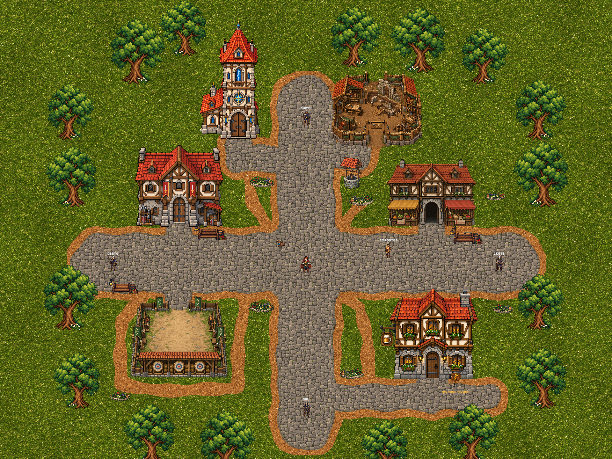
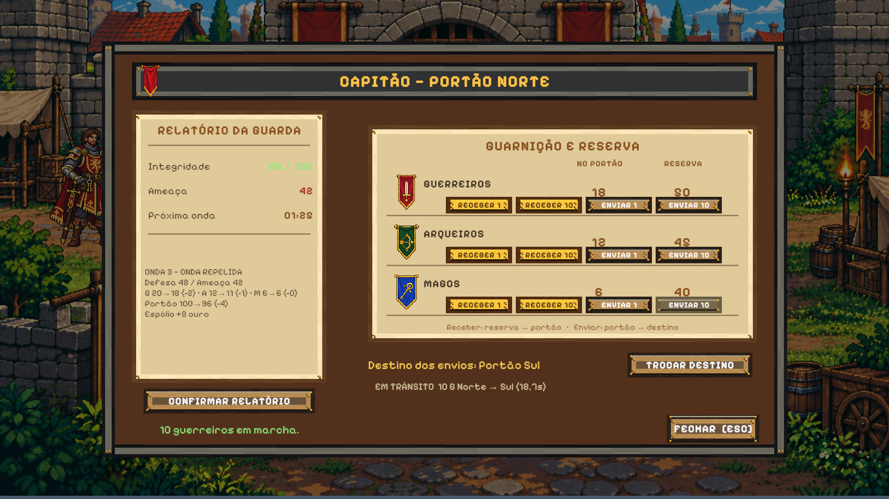
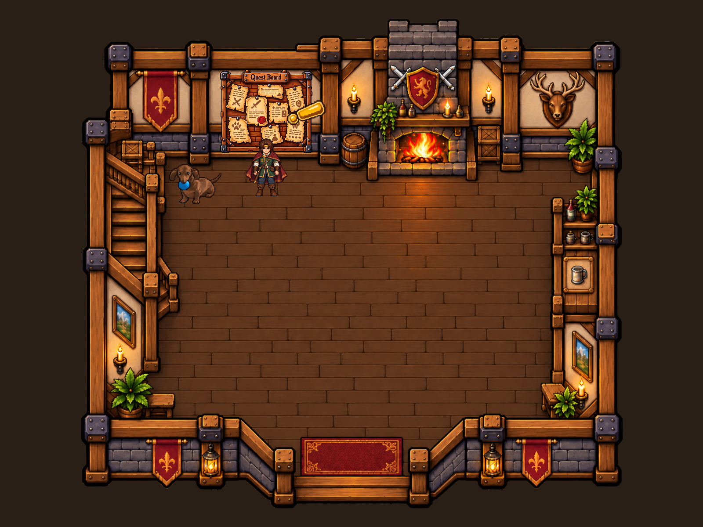

# PROCESSOS DE DESENVOLVIMENTO DE JOGOS INDIES

**Autores:** Gustavo Henrique Nascimento de Almeida; Marcos Vinicius Barbieri Alves

**Instituição:** Centro Universitário da Fundação Hermínio Ometto

**Curso:** Engenharia da Computação

**Orientador:** Prof. Dr. Maurício Acconcia Dias

**E-mails institucionais:** [preencher]

## Resumo

Este trabalho apresenta o desenvolvimento de um jogo independente 2D em que o jogador administra uma vila e a defende de ondas de inimigos. O jogador arrecada ouro, melhora construções, recruta tropas e contrata aventureiros para explorar regiões e obter materiais. A renda acumulada durante a ausência permite retomar essas decisões em sessões diferentes. O estudo de caso acompanha como uma equipe de dois estudantes organizou o trabalho, definiu as regras e integrou as mecânicas em Unity. A divisão por cenas permitiu desenvolver áreas em paralelo, enquanto a integração exigiu que a economia e os demais dados da partida fossem compartilhados. O protótipo resultante reúne gestão da vila, defesa e exploração. Em cenários controlados, a retomada disponibilizou a renda do período elegível e manteve o tempo de preparação para a próxima onda. O caso documenta como uma equipe pequena pode dividir o desenvolvimento de um jogo *idle*, reconhecer as dependências entre as mecânicas e verificar sua integração.

**Palavras-chave:** desenvolvimento independente, jogos idle, design de jogos

## 1 Introdução

### 1.1 Contexto e proposta do jogo

O projeto nasceu como um trabalho de Engenharia da Computação desenvolvido por dois estudantes. A proposta foi criar um jogo 2D de gestão e defesa de uma vila que pudesse ser jogado em sessões separadas. Ao voltar, o jogador encontra a vila no estado em que a deixou e pode usar a renda acumulada para decidir o que fazer a seguir.

A partida começa no Centro. O jogador recolhe impostos do Mercado Local e investe o ouro em construções, tropas ou aventureiros. As tropas defendem os quatro portões da vila. Os aventureiros são contratados na Taverna e enviados a regiões que oferecem materiais para novas melhorias. À medida que as ondas inimigas se aproximam, gastar ouro em uma melhoria ou reservar o recurso para a defesa muda as opções da próxima etapa da campanha.

O protótipo combina momentos de decisão com períodos de espera. Alharthi et al. (2018) observam que jogos *idle* permitem progresso com pouca interação direta e deslocam parte da atividade do jogador para o planejamento. No projeto, esse princípio aparece na produção de renda, na disponibilidade de recrutas e nas atividades da exploração. A defesa acrescenta uma condição ao ciclo. A preparação para cada onda depende de decisões que o jogador toma enquanto está na partida.

### 1.2 Problema de pesquisa

Em um jogo *idle* concebido para durar várias sessões, o jogador pode deixar uma tarefa em andamento e voltar horas depois. A equipe precisa definir o que progride nesse intervalo, o que espera pela próxima ação e como o jogo apresenta o estado resultante. Se a renda, o estoque e a defesa seguirem a mesma regra de tempo, uma ausência pode mudar tanto os recursos disponíveis quanto a oportunidade de preparar o portão. O projeto adotou regras próprias para cada sistema.

Esse problema afeta a gestão do desenvolvimento. Uma mudança na economia interfere nas compras do Portão e da Taverna, e uma mudança na agenda de ataques altera o tempo disponível para essas decisões. A equipe precisa ordenar as entregas, combinar regras compartilhadas e verificar um ciclo que pode envolver minutos de preparação e horas de ausência. Repetir toda a duração de cada cenário torna a verificação demorada. É preciso selecionar situações que representem as decisões do jogador ao longo da partida.

A pergunta deste trabalho é como uma equipe pequena pode organizar o desenvolvimento, integrar as mecânicas e verificar a progressão de um jogo *idle* pensado para várias sessões.

### 1.3 Justificativa

Jogos independentes ampliam a variedade de propostas disponíveis na indústria. Equipes pequenas podem experimentar regras e combinações de gêneros e ajustar a ideia à medida que produzem versões jogáveis. O estudo sobre *Noita*, por exemplo, documenta como protótipos e decisões sucessivas transformaram a ideia de um jogo independente ao longo do desenvolvimento (KULTIMA; OJANEN; NYLUND, 2024).

Os jogos *idle* exploram uma forma de jogar que alterna planejamento, espera e retorno. Há exemplos de alcance expressivo. No lançamento da versão 1.0 de *Melvor Idle*, a editora Jagex informou que o jogo já havia recebido mais de um milhão de jogadores entre PC e dispositivos móveis (JAGEX, 2021). Esse caso mostra como a progressão entre sessões pode fazer parte de uma proposta com público além de um único canal de distribuição.

O trabalho tem valor como experiência documentada de desenvolvimento acadêmico. A combinação de economia, defesa e exploração permite observar como a equipe transforma ideias de jogo em tarefas, resolve dependências e verifica o que o jogador encontra ao voltar. O registro dessas decisões pode servir de referência a estudantes e equipes que precisem planejar um protótipo com progressão distribuída ao longo do tempo.

### 1.4 Objetivos

O objetivo geral é desenvolver um protótipo independente de gestão e defesa de uma vila e analisar como a equipe organizou e integrou suas mecânicas para compor uma experiência *idle*. Os objetivos específicos descrevem o que o jogador deve poder fazer e como a equipe examina o ciclo resultante.

1. Desenvolver a economia da vila, com arrecadação de ouro e investimento em construções e melhorias.
2. Implementar a defesa dos portões, com avisos de ataque, distribuição de guarnições e resolução de ondas inimigas.
3. Criar a contratação de tropas para a defesa e de aventureiros na Taverna, com custos compartilhados pela economia da vila.
4. Implementar a exploração de regiões pela Taverna, com seleção de aventureiros, expedições, combates e obtenção de materiais.
5. Documentar a organização e a integração das entregas e verificar aspectos da experiência *idle*, como o que o jogador encontra e pode fazer ao retomar a partida.

### 1.5 Escopo e qualidades do protótipo

O protótipo é local, para um jogador, e inclui navegação entre Centro, Portão e Taverna, além da cena de combate de exploração. No Centro, reúne construções, melhorias, arrecadação e acompanhamento do saldo. A campanha inclui quatro portões, reserva e transferência de tropas, avisos, até dez ondas e registro de consequências das batalhas. O recrutamento inclui estoque e renovação de tropas. A Taverna concentra a contratação de aventureiros e o mapa de exploração. As expedições incluem deslocamento, combate, conquista de regiões, alocação de exploradores e guardas, coleta e transporte de materiais. A partida registra aventureiros, itens e progresso das regiões em um inventário persistente.

O projeto também definiu qualidades que atravessam as cenas. O saldo precisa ser consistente quando o jogador circula entre as áreas. O salvamento deve recuperar o progresso e lidar com formatos anteriores. A interface deve tornar visíveis o ouro, o estoque e o tempo até a próxima ameaça. As ações de movimento e interação devem seguir os mesmos controles. A separação entre regras e elementos visuais facilita ajustar parâmetros e verificar comportamentos sem depender da apresentação de cada cena.

A avaliação apresentada examina comportamentos do protótipo e o processo usado para integrá-los. A revisão bibliográfica situa essas decisões no desenvolvimento independente. A metodologia descreve como elas foram registradas e verificadas. Os resultados retomam o ciclo do jogo e discutem o que a implementação e as evidências permitem concluir.

## 2 Revisão bibliográfica

### 2.1 Desenvolvimento independente e organização do trabalho

Politowski et al. (2021) analisaram 200 relatos pós-projeto e identificaram dificuldades tanto de gestão quanto de produção. Em um estúdio independente, Poulsen e Wirman (2024) observaram que a equipe discutia as decisões criativas junto com a maneira de organizar o trabalho. Isso ajuda a explicar por que a divisão de tarefas depende do conteúdo que está sendo construído. A decisão sobre quais áreas podem avançar em paralelo muda quando elas começam a consumir o mesmo saldo ou a depender do mesmo inventário.

Kultima, Ojanen e Nylund (2024) usam uma linha do tempo de *Noita* para relacionar mudanças de design e etapas de produção. No projeto deste artigo, o cronograma de curto prazo foi revisto nas reuniões semanais. O Discord serviu para discutir as próximas entregas. O Trello registrou tarefas e pendências. O Git permitiu recuperar alterações nas cenas e marcos de integração. Esses registros ajudam a relacionar o que foi combinado com o que entrou no protótipo.

### 2.2 Documentação de design e dependências entre sistemas

O *Game Design Document* (GDD) registra regras e decisões que orientam a produção. Carrijo et al. (2023) discutem como sua organização pode variar conforme o gênero e as necessidades do projeto. Para uma equipe pequena, a documentação pode distribuir-se entre a proposta, cartões de tarefas e contratos técnicos, desde que as regras compartilhadas permaneçam identificáveis.

Neste jogo, uma descrição da defesa precisa indicar quando o ataque será anunciado, o que o jogador pode preparar e como a batalha usa a guarnição. A contratação depende de preço, disponibilidade e saldo. A exploração depende dos aventureiros contratados, do estado das regiões e do destino dos materiais. A economia reúne essas decisões porque cada compra consome recursos que poderiam ser usados em outra área. Registrar essas relações ajuda a definir a ordem das tarefas. Por exemplo, a Taverna pode desenvolver sua interface separadamente, mas a contratação precisa consultar o mesmo saldo do Centro.

### 2.3 Espera, planejamento e retorno em jogos idle

Alharthi et al. (2018) examinaram 66 jogos *idle* e os compararam com dez jogos de outros tipos. A taxonomia descreve formas de progressão com pouca interação, nas quais a espera e a automação abrem espaço para decisões de planejamento. A produção de recursos pode ocorrer enquanto o jogo está aberto. Quando o projeto admite progresso durante a ausência, o jogador também pode encontrar novos recursos ou tarefas prontas ao retornar.

As regras variam conforme a atividade. Em *Melvor Idle*, a atualização 1.1.2 estabeleceu que a cidade avançava em intervalos de uma hora, com até 24 horas contabilizadas durante a ausência (MELVOR IDLE, 2023). No protótipo deste trabalho, a arrecadação usa uma taxa de produção e um limite entre coletas. A defesa usa a espera para dar ao jogador tempo de se preparar. Essa diferença entre atividades é parte do desenho da partida.

### 2.4 Decisões de balanceamento

Pecorella (2016) descreve a relação entre o ritmo de produção e o custo das melhorias em jogos incrementais. No protótipo, o ouro acumulado permite escolher entre investir na renda futura, reforçar a defesa ou ampliar a exploração. O aumento do custo das construções conforme o nível e a exigência de materiais em algumas melhorias conectam a economia do Centro às expedições da Taverna.

O recrutamento limita as compras pelo estoque e pelo saldo disponível. A campanha, por sua vez, aumenta a força das ondas e reduz os intervalos de preparação nas etapas posteriores. Os avisos permitem reorganizar as guarnições antes do ataque. O limite de 24 horas de arrecadação restringe o ganho que pode ser acumulado entre duas coletas. São decisões que regulam quanto o jogador pode fazer em cada retorno e quanto precisa reservar para as próximas etapas.

### 2.5 Continuidade percebida e atualização ao retornar

A sensação de que a vila continuou produzindo vem da diferença entre o que o jogador deixou e o que encontra ao voltar. Para calcular essa diferença, o jogo grava os dados necessários e consulta o tempo decorrido quando a partida volta a ser executada. No caso dos impostos, uma taxa conhecida e um intervalo elegível permitem calcular a renda de uma vez. Na exploração, datas salvas permitem reconhecer chegadas e ciclos de coleta que venceram no intervalo.

O relógio do dispositivo fornece uma referência comparável entre sessões. O .NET permite representar esses instantes como segundos decorridos desde 1º de janeiro de 1970 em UTC (MICROSOFT, [s.d.]). A campanha usa o tempo de execução, medido pelos intervalos entre quadros. A propriedade `Time.unscaledDeltaTime` fornece esse intervalo independentemente da escala de tempo do motor (UNITY TECHNOLOGIES, [s.d.]d). A separação permite que o jogador encontre renda ao voltar e ainda tenha a oportunidade de reagir à próxima onda.

Essa percepção de continuidade depende da consistência do retorno. O estado apresentado precisa corresponder às regras de cada atividade, e uma nova abertura não deve repetir um crédito já recebido. Um relógio controlável permite representar durações diferentes sem aguardar todo o intervalo, como exemplifica a documentação da Microsoft (2026). A metodologia aplica essa ideia a situações que o jogador encontra durante o ciclo da vila.

## 3 Metodologia

### 3.1 Caracterização e fontes

A pesquisa é aplicada e examina o desenvolvimento de um jogo independente por uma equipe de dois estudantes. O caso inclui a definição das mecânicas, a divisão das entregas, a integração entre cenas e a verificação de comportamentos do protótipo. A progressão durante a ausência é um dos desafios analisados, pois exige decisões coordenadas entre economia, campanha e persistência.

A reconstrução do desenvolvimento usa a proposta, os documentos de regras, o quadro de tarefas e o histórico do Git. Foram selecionados registros que indicam a construção de uma área, a introdução de uma regra ou uma integração entre sistemas. A descrição de cada episódio relaciona o que a equipe precisava entregar, a dependência identificada e a alteração registrada. Para a retomada, o código e o relatório de testes documentam as condições da execução e os resultados. Esse encadeamento entre registros e conclusões segue a orientação de Runeson e Höst (2009) para estudos de caso em Engenharia de Software.

### 3.2 Definição das regras e ordem de implementação

A proposta inicial definiu uma vila 2D com progressão automática. A equipe organizou o trabalho em entregas que permitiam verificar partes do ciclo. No Centro, a primeira dependência era ter construções, produção de renda e um saldo que pudesse ser consultado. No Portão, a compra de guerreiros, arqueiros e magos precisava verificar estoque e ouro antes de transferir as unidades para a reserva. A defesa foi desenvolvida em torno dos avisos, da alocação de tropas e da resolução das ondas nos quatro portões.

A integração entre Centro e Portão exigiu definir qual saldo valia nas duas cenas e quais regras de compra e arrecadação deveriam ser preservadas. A Taverna passou a usar essa economia para contratar aventureiros. O mapa de exploração reúne a seleção da equipe, o deslocamento e o combate. As regiões conquistadas podem receber exploradores e guardas. Os materiais transportados entram no inventário e podem ser exigidos para melhorar construções.

Com essas dependências identificadas, a equipe atribuiu a cada atividade uma regra de tempo. Os impostos consideram o intervalo desde o último cálculo, limitado ao tempo restante entre coletas. O estoque de tropas tem um horário de reposição. As expedições registram prazos de deslocamento e retorno, e regiões com exploradores têm ciclos de coleta. A campanha conserva o tempo de preparação salvo e volta a avançar durante a sessão. O planejamento da defesa e o contrato de unificação registram parte dessas regras e serviram de base para a implementação e a seleção dos cenários.

### 3.3 Planejamento das entregas, divisão de tarefas e integração

A equipe se reunia semanalmente no Discord para discutir as próximas tarefas, dividir responsabilidades e registrar novas pendências. Entre as reuniões, o trabalho seguia de forma assíncrona e as dúvidas eram tratadas por mensagens. O quadro do Trello funcionava como o cronograma de curto prazo. Os integrantes acompanhavam as entregas pelas listas A Fazer, Fazendo, Revisando e Arquivado e atualizavam os itens dos cartões à medida que avançavam. A Figura 1 apresenta essa organização.

**Figura 1 — Quadro do Trello utilizado para acompanhar as tarefas do projeto**

Fonte: captura do quadro da equipe, fornecida pelos autores

O cartão do Portão Norte exemplifica como uma reunião se transformava em uma tarefa verificável. O escopo incluía um mapa pequeno, ouro inicial e um personagem responsável pelo recrutamento. A Figura 2 registra os comportamentos esperados para essa entrega e a posição do cartão na lista Revisando.

**Figura 2 — Cartão do Portão Norte no Trello**

Fonte: captura do quadro da equipe, fornecida pelos autores

A divisão também orientava o uso do Git. Em uma das reuniões, Marcos assumiu o Centro e Gustavo ficou com a Taverna. Como cada integrante trabalhava em uma cena diferente, os dois puderam avançar em paralelo e revisar as alterações antes da integração. Os commits `279c0ec`, `f6c4a2b` e `90726d3` registram trabalhos nessas frentes em momentos distintos. Em geral, a equipe mantinha uma branch por desenvolvedor e uma principal. Quando uma tarefa alterava regras comuns, como o saldo, a integração exigia combinar o comportamento antes de reunir as alterações.

### 3.4 Ferramentas e arquitetura do protótipo

A equipe adotou Unity e C# pela familiaridade com as ferramentas e pela disponibilidade de recursos para jogos 2D. O editor de cenas, a renderização de sprites e os componentes de interface permitiram trabalhar na apresentação enquanto as regras eram desenvolvidas em C#. *Cuphead* e *Hollow Knight* são exemplos de jogos independentes desenvolvidos com a ferramenta (UNITY TECHNOLOGIES, [s.d.]a, [s.d.]b). A revisão analisada usa Unity 6000.3.11f1.

A divisão em cenas ajudou a organizar o trabalho, mas os dados da partida precisavam acompanhar o jogador. A equipe centralizou o saldo, o inventário e o progresso em uma sessão compartilhada. As interfaces consultam essa sessão ao mostrar o ouro ou ao iniciar uma compra. O repositório grava o estado em JSON com armazenamento local em `PlayerPrefs`. Isso permite recuperar a partida e tratar versões anteriores do formato.

As regras de tempo ficam nos serviços que usam esses dados. A arrecadação, a reposição de tropas e atividades da exploração consultam o relógio do dispositivo. A campanha recebe o tempo de execução para manter a sequência de ataques. A interface `IClock` permite trocar o relógio real por um relógio controlado nos cenários de verificação. Essa escolha liga a arquitetura ao procedimento de avaliação.

### 3.5 Planejamento e execução da avaliação

A avaliação partiu de situações que o jogador encontra em uma partida distribuída ao longo do tempo. Ao retornar, ele precisa conseguir consultar a renda, recolhê-la uma vez e verificar quanto tempo ainda tem para se preparar para um ataque. Esses comportamentos foram escolhidos porque conectam espera, economia, salvamento e defesa. Um resultado incorreto altera as opções de compra ou a oportunidade de preparar a vila.

Os cenários foram definidos a partir das regras de retorno. A abertura imediata indica o que acontece sem tempo elegível. Um intervalo de seis minutos permite verificar um ganho curto. Intervalos imediatamente antes, no limite e depois de 24 horas distinguem a produção do efeito do teto de acúmulo. Um salvamento com parte do limite já consumida verifica se a retomada respeita o saldo de tempo disponível. Uma nova abertura após a coleta confere a persistência do ouro. Um cenário da campanha verifica quanto falta para a onda após uma ausência prolongada.

A rodada de 10 de novembro de 2026 usou o Unity Test Framework 1.6.0 em *Edit Mode*, no Windows (UNITY TECHNOLOGIES, [s.d.]c). As partidas foram gravadas em chaves isoladas e carregadas em novas sessões do mesmo processo. Nos cenários de arrecadação, o estado inicial tinha 1.000 unidades de ouro e Mercado Local no nível 3, com produção de 20 unidades por minuto. Foram comparados o valor disponível, o crédito e o saldo. O [relatório da execução](Evidencias/testes/Resultados_da_retomada_2026-11-10.md) registra os cenários e como repeti-los.

## 4 Desenvolvimento e resultados

### 4.1 Evolução do protótipo e integração das entregas

O Centro e o Portão foram desenvolvidos inicialmente com saldos separados. Quando a equipe reuniu as alterações, o ouro produzido no Centro precisava estar disponível para recrutar tropas. O commit `4fc66a0`, de agosto de 2026, registra essa integração. O [contrato de unificação](UnificationBehaviorContract.md) estabeleceu o saldo compartilhado e registrou as regras de produção, acúmulo e compra que deveriam ser preservadas. Assim, duas frentes que podiam avançar separadamente passaram a depender de uma regra comum de atualização do estado.

Em setembro, o commit `e79782b` registrou a ampliação da campanha para quatro portões e uma reserva de tropas. A divisão entre Centro e Taverna permitiu avançar no ambiente e na seleção de aventureiros. Com a exploração, a equipe precisou ligar o inventário da Taverna às melhorias do Centro. O commit `2436b78`, de novembro, registra a introdução de itens e do relatório de exploração. Essa sequência mostra por que a integração passou a envolver tanto a circulação do jogador quanto o uso de recursos produzidos em outras cenas.

### 4.2 Experiência de jogo e sistemas disponíveis

No Centro, o jogador acompanha o ouro e decide se investe em produção, tropas ou aventureiros. O Mercado Local gera renda, e as construções ampliam as possibilidades da vila. A Figura 3 apresenta a área em que o jogador inicia esse ciclo.

**Figura 3 — Centro da vila**

Fonte: captura do protótipo, 5 de novembro de 2026

Quando a campanha anuncia uma ameaça, o jogador consulta o portão previsto e prepara a guarnição. As tropas podem permanecer na reserva ou ser distribuídas entre os acessos da vila. A resolução da onda considera a defesa disponível e registra consequências para a campanha. A Figura 4 mostra a interface de gestão das guarnições.

**Figura 4 — Painel de guarnição do Portão**

Fonte: captura do protótipo, 27 de outubro de 2026

A Taverna oferece outra forma de investir o ouro. O jogador contrata aventureiros e seleciona até três para uma expedição. O mapa acompanha o deslocamento, o combate e o progresso nas regiões. Nas áreas conquistadas, é possível alocar exploradores e guardas e transportar recursos para o inventário. Os materiais retornam ao ciclo do Centro quando são usados em melhorias. A Figura 5 apresenta o ambiente da Taverna.

**Figura 5 — Interior da Taverna**

Fonte: captura do protótipo, 5 de novembro de 2026

### 4.3 Retomada da partida

Ao retornar, o jogador pode consultar o ouro disponível para coleta e o tempo de preparação para a próxima onda. Para a renda, o jogo calcula o intervalo desde o último cálculo e usa apenas a parte que cabe no limite restante de 24 horas entre coletas. O serviço multiplica esse intervalo pela produção do Mercado Local. A consulta apresenta uma prévia. Na coleta, o valor inteiro entra no saldo, a fração permanece acumulada e o limite reinicia quando há crédito.

A defesa conserva o estado em que o jogador deixou a campanha. O salvamento registra o contador e a agenda das ondas. Ao carregar a partida, o contador retoma a contagem a partir do ponto gravado. A arrecadação pode, assim, dar ao jogador novos recursos para decidir como defender o portão antes de o tempo de preparação acabar.

### 4.4 Verificação dos comportamentos de retorno

A rodada partiu da revisão `9abb425`, de 9 de novembro de 2026, com as alterações de isolamento do salvamento e os novos cenários de retomada. Foram aprovados os 23 casos selecionados. Oito verificaram a retomada, cinco trataram da persistência da campanha e dez examinaram a recuperação de dados do salvamento. A Tabela 1 apresenta os resultados ligados diretamente às situações de retorno.

**Tabela 1 — Valores esperados e observados nos cenários de retomada**

| Cenário | Esperado | Observado | Resultado |
| --- | --- | --- | --- |
| Retomada imediata | 0 de imposto | 0 de imposto | Aprovado |
| 6 minutos de ausência | 120 de imposto | 120 de imposto | Aprovado |
| 23h59min59s de ausência | 28.799 de imposto | 28.799 de imposto | Aprovado |
| 24 horas de ausência | 28.800 de imposto | 28.800 de imposto | Aprovado |
| 48 horas de ausência | 28.800 de imposto | 28.800 de imposto | Aprovado |
| 2 horas de ausência com 23h30 de acúmulo já usadas | Acréscimo de 600 | Acréscimo de 600 | Aprovado |
| Novo carregamento após a coleta, sem avanço do relógio | Crédito adicional de 0 e saldo de 1.120 | Crédito adicional de 0 e saldo de 1.120 | Aprovado |
| Campanha retomada após 48 horas simuladas | 132,75 s até a onda | 132,75 s até a onda | Aprovado |

Fonte: elaboração própria a partir do [relatório XML do Unity Test Framework](Evidencias/testes/RetomadaEditMode-2026-11-10.xml)

Os cenários de 24 e 48 horas resultaram na mesma renda, conforme o limite. A verificação com parte do intervalo já usada mostrou que a regra também se aplica quando o jogador alterna sessões antes de recolher os impostos. A abertura após a coleta preservou o saldo e a campanha manteve o tempo disponível até a onda.

As Figuras 6 a 8 apresentam o cenário de seis minutos do ponto de vista da interface. O serviço calculou os valores em sessões isoladas e um cenário de captura apresentou cada estado na mesma vista do Centro. A sequência começa no estado salvo, com saldo de 1.000 e nenhum imposto disponível.

**Figura 6 — Estado salvo antes da retomada simulada**

Fonte: elaboração própria, captura da interface do protótipo em cenário controlado

A Figura 7 mostra 120 unidades disponíveis após a ausência simulada. O saldo continua em 1.000 até o jogador recolher os impostos.

**Figura 7 — Impostos disponíveis após seis minutos simulados**

Fonte: elaboração própria, captura da interface do protótipo em cenário controlado

A Figura 8 mostra a confirmação da coleta e o saldo de 1.120. Esse é o valor que fica disponível para a próxima decisão de investimento.

**Figura 8 — Saldo após a coleta de impostos**

Fonte: elaboração própria, captura da interface do protótipo em cenário controlado

### 4.5 Discussão e limites da avaliação

A divisão do trabalho por cenas ajudou a equipe a avançar nas interfaces e mecânicas locais. O caso do saldo mostra onde essa divisão deixou de ser suficiente. A integração precisou estabelecer quais regras pertenciam à partida como um todo. O contrato registrou as decisões, e a sessão compartilhada deu ao Centro, ao Portão e à Taverna a mesma informação para produção, compra e contratação. Essa relação entre decisões de design e organização do trabalho também aparece no estudo de Poulsen e Wirman (2024).

A separação dos relógios resolveu outra dependência. A renda podia considerar a ausência, enquanto a campanha precisava conservar a oportunidade de reação. Os cenários controlados mostraram o comportamento dessas duas regras em novas sessões. A cobertura da rodada se concentra na retomada, na campanha e na persistência. A experiência completa envolve também a navegação, o recrutamento e a exploração ao longo de uma partida.

As conclusões sobre gestão vêm de uma equipe e de seus próprios registros. O histórico documenta alterações, e os cartões ajudam a recuperar o escopo. Parte das decisões de reunião foi reconstruída pelos próprios desenvolvedores. Os resultados da retomada correspondem às condições simuladas no editor. A confirmação do percurso pelo executável, com encerramento e reabertura, é uma etapa posterior.

## 5 Conclusão

O desenvolvimento reuniu economia, defesa, contratação e exploração em um protótipo *idle* de gestão de vila. O trabalho pôde avançar em paralelo quando as tarefas pertenciam a cenas diferentes. Nas entregas que envolviam o mesmo ouro ou inventário, a equipe precisou documentar as regras e integrar os sistemas em torno de um estado comum. As reuniões, o quadro de tarefas e o histórico do código permitiram acompanhar essas decisões.

Para organizar um jogo pensado para várias sessões, o caso indica que a equipe pode definir primeiro o que o jogador faz em cada área e depois identificar os dados que precisam atravessar as cenas e os intervalos de ausência. No protótipo, essa abordagem permitiu reunir as decisões do Centro, do Portão e da Taverna. Os cenários de retorno confirmaram que a renda calculada fica disponível para coleta e que o tempo da defesa é preservado nas condições avaliadas.

A contribuição do trabalho é registrar as decisões de desenvolvimento que deram forma a esse ciclo de jogo. Uma próxima etapa é acompanhar o percurso pelo executável, da preparação da vila à reabertura da partida, para observar as mecânicas integradas na sequência em que o jogador as utiliza.

## REFERÊNCIAS

ALHARTHI, Sultan A. et al. Playing to wait: a taxonomy of idle games. In: CHI CONFERENCE ON HUMAN FACTORS IN COMPUTING SYSTEMS, 2018, Montreal. *Proceedings [...]*. New York: Association for Computing Machinery, 2018. Art. 621. DOI: [10.1145/3173574.3174195](https://doi.org/10.1145/3173574.3174195).

CARRIJO, Gabriel F. et al. Uma revisão sistemática de literatura acerca de Game Design Documents, uma proposta para a criação de um roteiro de jogo otimizado. In: SIMPÓSIO BRASILEIRO DE JOGOS E ENTRETENIMENTO DIGITAL, 22., 2023, Rio Grande. *Anais Estendidos [...]*. Porto Alegre: Sociedade Brasileira de Computação, 2023. p. 43–53. Disponível em: [SBC OpenLib](https://sol.sbc.org.br/index.php/sbgames_estendido/article/download/27796/27606/). Acesso em: 10 nov. 2026.

JAGEX. *Melvor Idle version 1.0 launches on PC and mobile*. Cambridge, 18 nov. 2021. Disponível em: [Comunicado da editora](https://www.jagex.com/news/melvor-idle-version-1-0-launches-on-pc-and-mobile). Acesso em: 10 nov. 2026.

KULTIMA, Annakaisa; OJANEN, Riina; NYLUND, Niklas. Noita: a long journey of a game idea. *Transactions of the Digital Games Research Association*, v. 7, n. 1, p. 155–181, 2024. DOI: [10.26503/todigra.v7i1.2186](https://doi.org/10.26503/todigra.v7i1.2186).

MELVOR IDLE. *Major update: Township rework, v1.1.2*. Steam, 11 abr. 2023. Disponível em: [Notas da atualização](https://steamcommunity.com/games/1267910/announcements/detail/3700311793101067361). Acesso em: 10 nov. 2026.

MICROSOFT. *DateTimeOffset.ToUnixTimeSeconds Method*. Microsoft Learn, [s.d.]. Disponível em: [Documentação da API .NET](https://learn.microsoft.com/en-us/dotnet/api/system.datetimeoffset.tounixtimeseconds). Acesso em: 10 nov. 2026.

MICROSOFT. *Testando com FakeTimeProvider*. Microsoft Learn, 11 mar. 2026. Disponível em: [Documentação do .NET](https://learn.microsoft.com/pt-br/dotnet/core/extensions/timeprovider-testing). Acesso em: 10 nov. 2026.

PECORELLA, Anthony. *The math of idle games, part I*. Game Developer, 13 out. 2016. Disponível em: [Game Developer](https://www.gamedeveloper.com/design/the-math-of-idle-games-part-i). Acesso em: 10 nov. 2026.

POLITOWSKI, Cristiano et al. Game industry problems: an extensive analysis of the gray literature. *Information and Software Technology*, v. 134, art. 106538, 2021. DOI: [10.1016/j.infsof.2021.106538](https://doi.org/10.1016/j.infsof.2021.106538).

POULSEN, Mark Staun; WIRMAN, Hanna. Creative-rational tensions in game development: a Danish case study on team collaboration. *Transactions of the Digital Games Research Association*, v. 7, n. 1, p. 89–124, 2024. DOI: [10.26503/todigra.v7i1.2184](https://doi.org/10.26503/todigra.v7i1.2184).

RUNESON, Per; HÖST, Martin. Guidelines for conducting and reporting case study research in software engineering. *Empirical Software Engineering*, v. 14, p. 131–164, 2009. DOI: [10.1007/s10664-008-9102-8](https://doi.org/10.1007/s10664-008-9102-8).

UNITY TECHNOLOGIES. *Cuphead*. Made with Unity, [s.d.]a. Disponível em: [Estudo de caso](https://unity.com/made-with-unity/cuphead). Acesso em: 10 nov. 2026.

UNITY TECHNOLOGIES. *Hollow Knight*. Made with Unity, [s.d.]b. Disponível em: [Estudo de caso](https://unity.com/made-with-unity/hollow-knight). Acesso em: 10 nov. 2026.

UNITY TECHNOLOGIES. *Test Framework*. Unity 6.3 User Manual, [s.d.]c. Disponível em: [Manual da Unity](https://docs.unity.com/en-us/engine/6000.3/manual/packages-list/packages-all/pack-core/com-unity-test-framework). Acesso em: 10 nov. 2026.

UNITY TECHNOLOGIES. *Time.unscaledDeltaTime*. Unity 6.3 Scripting API, [s.d.]d. Disponível em: [Referência da Unity](https://docs.unity.com/en-us/engine/6000.3/script-reference/unityengine/time/unscaleddeltatime). Acesso em: 10 nov. 2026.
